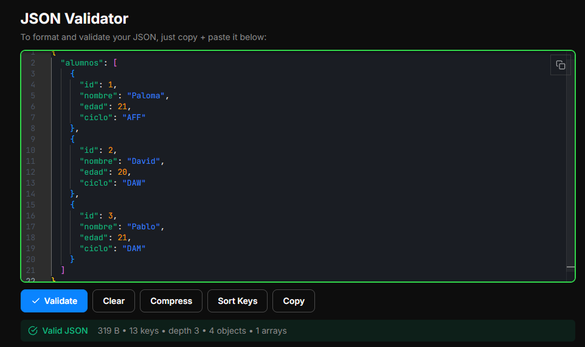

- ## 1. Identifica el objeto principal, el array alumnos, sus objetos y ejemplos de claves y valores. Indica el tipo de dato de los valores.

  El objeto principal es el propio JSON, delimitado por {...}, y tiene una clave principal "alumnos".

  Array Alumnos: delimitado por [...]. Contiene dos elementos separados por comas y dentro de {...}.

  Objetos: Cada elemento del array es un objeto con los mismos cuatro campos (id, nombre, edad, curso).

  Ejemplos clave - valor: "alumnos": [] -> Array, "id": 1 -> número (number), "nombre": "Lucía" -> cadena de texto (String), "edad": 19 -> número (number), "ciclo": "DAM" -> cadena de texto (String)

- ## 2. Crea alumnos.json con al menos tres alumnos diferentes y los campos id, nombre, edad y ciclo.

  [JSON](alumnos.json)

- ## 3. Comprueba que el JSON es válido y explica por qué la colección de alumnos se representa mediante un array.

Contiene pares Clave-Valor y tiene el formato correcto de un JSON

